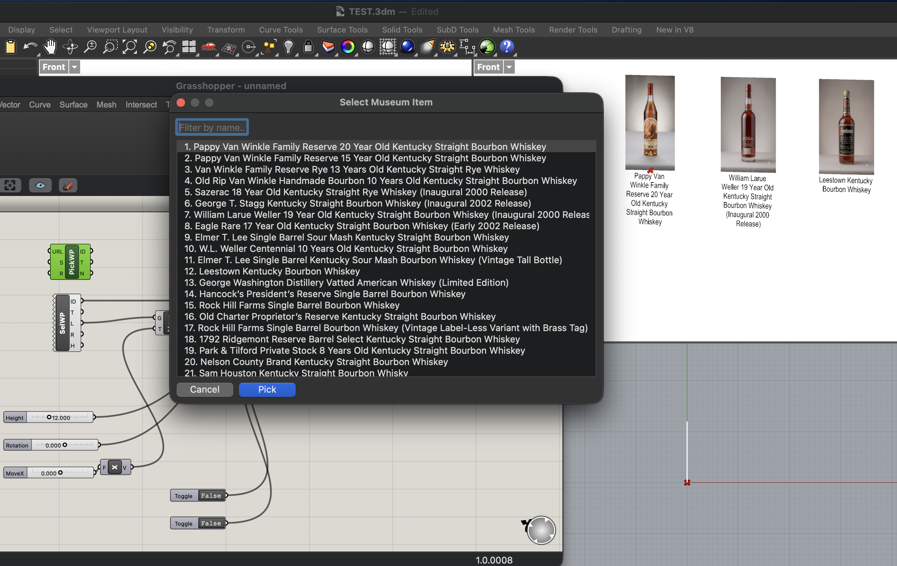

# Grasshopper-Plugin



---

## 🚀 Overview

This custom C# compiled Grasshopper assembly (.gha) establishes a real-time data bridge between a headless WordPress CMS—powered by Advanced Custom Fields (ACF) Pro—and the Rhino/Grasshopper CAD environment. By exposing structured metadata through WordPress REST API endpoints, the plugin enables content managers to control, enrich, and parametrically drive spatial geometry, material properties, and architectural attributes directly within 3D CAD scenes.

### 1. Primary Use Cases Dynamic Architectural Dashboards
Displaying real-time leasing data, square footage calculations, or construction costs visually mapped onto 3D building massing models.

### 2. Automated Spatial Signage & Wayfinding
Generating dynamic 3D typography, room numbers, and tenant logos derived directly from web directory databases.

### 3. Parametric Product Configurator Sync
Updating 3D product variations, material swatches, and dimensions based on e-commerce catalog specifications hosted in WordPress.

---

## 📐 Data Pipeline & Architecture

The system operates across four primary operational layers, ensuring low-latency data fetching and smooth geometry execution:

```
┌─────────────────────────────────┐
│     WordPress + ACF Pro         │
│     (Headless REST API)         │
└────────────────┬────────────────┘
                 │
                 │ JSON Payload
                 ▼
┌─────────────────────────────────┐
│       Grasshopper-Plugin        │
│   ┌─────────────────────────┐   │
│   │ Network / Data Layer    │   │  <-- Asynchronous HTTP & Data Models
│   └────────────┬────────────┘   │
│                │                │
│   ┌────────────▼────────────┐   │
│   │ GH_Component Wrapper    │   │  <-- Canvas Interface & Parametric Outputs
│   └────────────┬────────────┘   │
└────────────────┼────────────────┘
                 │
                 │ Parsed Metadata Lists
                 ▼
┌─────────────────────────────────┐
│       Rhino 3D Scene            │
│ (Geometry bound by WP_ID text)  │
└─────────────────────────────────┘

```

---

### 1. Content & Metadata Layer (WordPress + ACF Pro)
* **Data Structuring:** Custom Post Types (CPTs) combined with ACF Pro field groups define spatial attributes (e.g., dimensions, material specs, IDs, occupancy rates, pricing, visibility toggles).
* **API Delivery:** WP REST API endpoints export formatted JSON payloads, stripped of redundant HTML markup, optimized for headless consumption.

### 2. Integration & Processing Layer (C# Grasshopper Plugin)
* **Asynchronous Data Ingestion:** Built using .NET (`HttpClient`), the custom C# components query API endpoints asynchronously without freezing the Rhino UI thread.
* **Payload Parsing & Mapping:** JSON response payloads are parsed using `Newtonsoft.Json` into strong-typed C# objects, which are then output as native Grasshopper lists and primitive types (IDs, titles, numbers, JSON) or placed straight into the Rhino scene.
* **Fetch on Demand:** Components only contact the site when you ask them to (a `Fetch`, `Place` or `Refresh` input set to `true`), and the collection picker keeps its list until you refresh it. Downloaded item images are cached in the system temp folder so they are fetched once.

### 3. Parametric Geometry Layer (Grasshopper + RhinoCommon)
* **Attribute-Driven Geometry:** Ingested metadata feeds directly into Grasshopper definitions to dictate parametric transforms (scale, array counts, extrusion heights, colors, or structural profiles).
* **BIM & GIS Attribute Assignment:** Metadata is attached directly to geometry as user text attributes (`RhinoObject.Attributes.SetUserString`), enabling downstream export to IFC, Speckle, or visual rendering engines.

---

## 🔑 Key Functional Capabilities

* **Decoupled Workflow:** Design teams manage parametric logic inside Rhino/Grasshopper while non-technical stakeholders (project managers, interior designers, clients) manipulate spatial variables via the familiar WordPress dashboard.
* **On-demand Synchronization:** Manual `Fetch`, `Place` and `Refresh` triggers pull live site content into the active CAD session, one item at a time or the whole collection. There is no automatic polling.
* **Error Reporting:** Components show failed requests, empty URLs and missing images as standard Grasshopper warnings and errors on the node, so a dropped connection or missing featured image does not crash the definition.
* **Scene Placement and Editing:** Collection items become textured, labelled planes in Rhino that can be moved with the gimbal, edited from Grasshopper, or removed again.

---

## 🖼️ Building a Scene from the Collection

The **Museum → Collection** components pull collection items (the `museum-item` post type) from WordPress and place them in Rhino. Each item becomes a vertical plane textured with its featured image, with its name as a wrapped label centred beneath it. Every placed object carries user text (`WP_ID`, `WP_Number`, `WP_Title`, `WP_Subtitle`, `WP_Location`, `WP_Proof`, `WP_Era`, `WP_Link`) on a `Collection Items` layer, so Bind Geometry Data can join it back to its record.

### Build a fresh item

1. Add **Select Museum Item** (`PickWP`) from the Museum tab. Double-click it to open a window with a filter box and the numbered list of items, then pick one. Its name shows under the component. It outputs the item's `ID`, `Title` and `Number`. Its optional `Search` input narrows the list on the server, and `Refresh` fetches it again.
2. Add **Place Collection Item** and wire PickWP's `ID` into its `ID` input.
3. Set the other inputs:

   | Input | Meaning |
   |-------|---------|
   | `Location` | A point. The middle of the plane's bottom edge |
   | `Rotation` | Optional. Turn about the Z axis, in degrees (0 faces the Front view) |
   | `Height` | Plane height in model units, e.g. 12. Width follows the image's aspect ratio |
   | `Place` | `true` places the item |
   | `Remove` | `true` takes the item out of the scene instead |
   | `Plane` | Optional. Places the item on an exact plane, overriding `Location` and `Rotation` |

4. Wire a **Boolean Toggle** into `Place` and set it to `true`. The item appears in Rhino as a textured plane with its name beneath it. Switch the viewport to **Rendered** to see the image.
5. For the next item, pick a different one in PickWP and give it a new `Location`. Placing a second item does not remove the first. To keep every item editable from the canvas, use one PickWP and Place Collection Item pair per item.

Placing the same item again moves it rather than duplicating it, and if the item already sits where the inputs say, nothing changes. **Place All Collection Items** lays every item out in a single row ordered by collection number, which is handy for a quick overview. **Search Museum Items** returns plain lists of IDs, titles and numbers if you would rather work with the results directly.

Textures need a PNG or JPG. The site serves WebP, which Rhino cannot read, so the plugin downloads the original upload next to the WebP and falls back to converting the WebP with macOS's built-in `sips`.

### Edit an item already in the scene

**In Rhino, with no wiring.** Click the item's plane or label. They are grouped, so both are selected. Drag the gimbal to move, rotate or scale it. You are editing the Rhino objects directly. Items placed before the plane and label were grouped need placing once more.

**Through Grasshopper.**

1. Add **Selected Collection Item** (`SelWP`). It follows whichever item you click in Rhino and keeps its reading when you deselect. It outputs `ID`, `Title`, `Location`, `Rotation`, `Height` and the exact `Plane`.
2. Wire its `Plane` and `Height` into Place Collection Item's `Plane` and `Height`, and its `ID` into `ID`. A gimbal edit then survives re-solving.
3. To change an item by number instead, give Place Collection Item new `Location`, `Rotation` or `Height` values and set `Place` to `true`.
4. To remove it, wire its `ID` into Place Collection Item and set `Remove` to `true`.

Do not put a Move between SelWP and the placer when you also use the gimbal, because the offset is applied again on each update.

---

## 📥 Install

Download the latest build from the [Releases page](https://github.com/bourbon-museum/Grasshopper-Plugin/releases/latest), unzip it, and copy the `.gha` into your Grasshopper Libraries folder with Rhino closed:

| Platform | Libraries folder |
|----------|------------------|
| Windows | `%APPDATA%\Grasshopper\Libraries\` |
| Mac | `~/Library/Application Support/McNeel/Rhinoceros/8.0/Plug-ins/Grasshopper (b45a29b1-4343-4035-989e-044e8580d9cf)/Libraries/` |

On Windows, unblock the file first if it is flagged (right-click the `.gha` → Properties → Unblock). Relaunch Rhino, open Grasshopper, and look for the **Museum** tab, which has a **Collection** panel and a **Data** panel.

* **Rhino 7** needs `Grasshopper-Plugin-net48.zip` (it only loads .NET Framework plugins).
* **Rhino 8** can use either `net7.0` or `net48`.

To build from source: `dotnet build Grasshopper-Plugin.sln -c Release`. Both targets (`net7.0` and `net48`) build into `Grasshopper-Plugin/bin/Release/`.

---

## 📄 File Structure

* **`Grasshopper-Plugin/`**
  * `.gitignore` — Visual Studio / .NET gitignore template
  * `README.md` — Project overview and architectural design
  * `docs/` — Screenshots used in the README
  * `Grasshopper-Plugin.sln` — Solution file
  * **`Grasshopper-Plugin/`** (Main C# Project)
    * `Grasshopper-Plugin.csproj` — .NET project dependencies & build targets
    * `PluginInfo.cs` — Grasshopper assembly registration metadata
    * **`Models/`** — Data transfer objects for JSON deserialization
      * `MuseumObject.cs` — Core WordPress Post attributes
      * `AcfData.cs` — ACF custom field payload definitions (distillery posts)
      * `CollectionItem.cs` — Collection item (`museum-item`) posts, their ACF fields and media records
      * `TaxonomyTerm.cs` — Taxonomy terms used for search filtering
    * **`Services/`** — External communication and Rhino document logic
      * `WordPressRestClient.cs` — Async HTTP client for endpoint querying, paging and media download
      * `CollectionPlacement.cs` — Places, replaces, groups and removes collection items in the Rhino document
    * **`Components/`** — Grasshopper canvas components
      * `FetchMuseumData.cs` — Fetches a REST endpoint and exposes IDs, titles and ACF data
      * `SearchMuseumItems.cs` — Searches the collection by name and taxonomy term
      * `SelectMuseumItem.cs` — Pick a collection item by name from a filterable list
      * `PlaceCollectionItem.cs` — Places, moves or removes one collection item in the scene
      * `PlaceCollectionItems.cs` — Places every collection item in a row
      * `SelectedCollectionItem.cs` — Reads the item selected in Rhino and follows gimbal edits
      * `BindGeometryData.cs` — Helper node to link geometry to data by ID

---

## 🛠️ Overview of Key Layers

### Models
C# classes representing the expected JSON schema from the WordPress REST API and ACF Pro custom field groups.

### Services
Network handling logic responsible for asynchronously fetching JSON data from specified URLs.

### Components
Custom Grasshopper nodes (GH_Component) that expose URL inputs and trigger parameters on the canvas, delivering structured data parameters to downstream Grasshopper wires.

### Geometry Binding
The design logic that uses native Rhino Attribute User Text (WP_ID) on 3D objects to join spatial elements with corresponding CMS metadata records.
